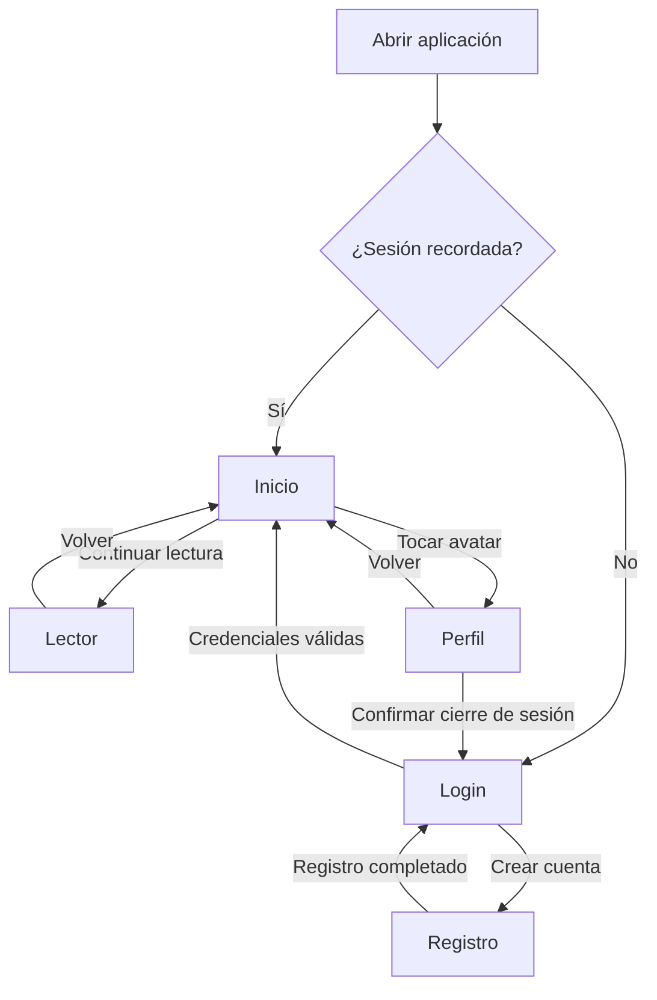

# Lexis ⚖️

Aplicación Android de biblioteca jurídica desarrollada en Kotlin con Jetpack Compose. Permite crear una cuenta local, acceder a un inicio personalizado y consultar un documento legal de demostración.

Proyecto realizado para la Evaluación 2 de Desarrollo de Aplicaciones Móviles.

## Funcionalidades

- **Registro de usuarios:** nombre, correo, contraseña y tipo de usuario.
- **Validación de formularios:** campos obligatorios, formato del correo, confirmación de contraseña y correos duplicados.
- **Inicio de sesión:** autenticación con usuarios almacenados localmente y opción de recordar sesión.
- **Inicio personalizado:** nombre, iniciales y saludo según la hora.
- **Consulta de categorías:** filtrado de materias por texto.
- **Lector de artículos:** documento de demostración con ajuste del tamaño de letra.
- **Perfil:** visualización de los datos del usuario y captura de foto mediante la cámara.
- **Cierre de sesión:** confirmación de salida y eliminación de la sesión recordada.

## Tecnologías

| Tecnología | Uso |
|---|---|
| Kotlin | Lógica de la aplicación |
| Jetpack Compose y Material 3 | Interfaz de usuario |
| Navigation Compose | Navegación entre pantallas |
| ViewModel y StateFlow | Manejo del estado |
| Coroutines | Operaciones asíncronas |
| Room y KSP | Persistencia local |
| FileProvider y Activity Result API | Captura de fotografías |

## Organización del proyecto

El código sigue una estructura basada en MVVM, con un repositorio para el acceso a los datos.

```text
com.example.lexis/
├── model/          # Entidades, DAO, base de datos y contenido de demostración
├── repository/     # Acceso a usuarios y almacenamiento de fotografías
├── ui/
│   ├── components/ # Componentes compartidos
│   ├── inicio/
│   ├── lector/
│   ├── login/
│   ├── navigation/
│   ├── perfil/
│   ├── registro/
│   └── theme/
├── util/           # Validaciones y utilidades
├── viewmodel/      # Estado y lógica de las pantallas
├── LexisApplication.kt
└── MainActivity.kt
```

## Flujo de navegación



## Instalación y ejecución

1. Clonar el repositorio o descargar su código.
2. Abrir la carpeta raíz del proyecto en Android Studio.
3. Instalar los componentes del SDK que solicite el proyecto.
4. Sincronizar los archivos de Gradle.
5. Seleccionar un dispositivo o emulador compatible con el `minSdk` definido en `app/build.gradle.kts`.
6. Ejecutar la aplicación con **Run**.

También se puede generar el APK de depuración desde la terminal de Windows:

```powershell
.\gradlew.bat assembleDebug
```

El APK se genera en:

```text
app/build/outputs/apk/debug/app-debug.apk
```

## Recorrido de prueba

1. Crear una cuenta desde **Crear cuenta**.
2. Iniciar sesión con el correo y la contraseña registrados.
3. Comprobar los datos del inicio.
4. Abrir **Continuar lectura** y ajustar el tamaño del texto.
5. Entrar al perfil tocando el avatar.
6. Conceder el permiso de cámara y tomar una fotografía.
7. Volver al inicio y comprobar que aparece la foto.
8. Cerrar sesión desde el perfil.

Para comprobar **Recordar sesión**, activar la opción al ingresar y volver a abrir la aplicación sin cerrar sesión.

## Almacenamiento y permisos

Los usuarios se almacenan en una base de datos Room dentro del dispositivo. Las contraseñas se almacenan como un hash, y las fotografías se guardan en el almacenamiento interno de la aplicación.

La aplicación solicita acceso a la cámara al tomar una foto de perfil. Si el permiso se rechaza, muestra un aviso.

## Alcance de la demostración

- La autenticación es local; no utiliza un servidor.
- El lector muestra una ley ficticia de demostración y no carga archivos PDF.
- Las categorías, novedades y el progreso mostrado en el inicio contienen datos de demostración.
- La recuperación de contraseña muestra un mensaje simulado; no envía correos.
- Borrar los datos de la aplicación elimina las cuentas, sesiones y fotografías locales.

## Integrantes

- **Martin Sandoval** — [@juice999k](https://github.com/juice999k)
- **Lukas Vicker** — [@Vicker10](https://github.com/Vicker10)
