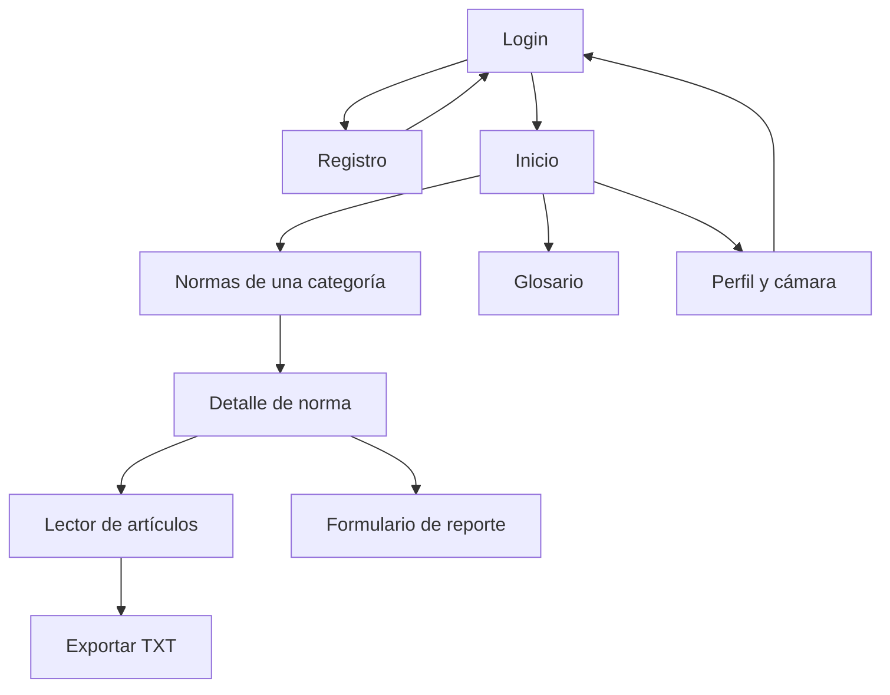

# Lexis - Biblioteca jurídica ⚖️

Aplicación Android desarrollada en Kotlin y Jetpack Compose. Permite consultar categorías, normas, resúmenes de artículos y términos jurídicos desde una API en Xano. Incluye cuentas locales, reportes de contenido, fotografía de perfil y exportación de artículos a texto.

## Funcionalidades

- Registro e inicio de sesión local con validación de formularios y opción de recordar sesión.
- Inicio personalizado con nombre, avatar y saludo.
- Categorías remotas con búsqueda local por nombre.
- Listado de normas filtrado por categoría y pantalla de detalle.
- Lectura de artículos remotos, ordenados por número, con tamaño de letra entre 12 y 26 sp.
- Novedades de la biblioteca obtenidas desde Xano.
- Glosario remoto con búsqueda local por término.
- Envío de reportes generales de normas mediante POST, con descripción de entre 10 y 1000 caracteres.
- Estados de carga, mensajes de error y reintento en consultas remotas.
- Captura de fotografía de perfil mediante la cámara.
- Exportación de los artículos cargados a un archivo `.txt` mediante el selector de documentos de Android.
- Ícono personalizado de Lexis.

## Tecnologías

| Tecnología | Responsabilidad |
|---|---|
| Kotlin | Lógica de la aplicación |
| Jetpack Compose y Material 3 | Interfaz y componentes visuales |
| Navigation Compose | Navegación y argumentos de categoría/norma/usuario |
| ViewModel y StateFlow | Estado y lógica de presentación |
| Coroutines | Operaciones suspendibles y escritura de archivos en IO |
| Retrofit y Gson | Solicitudes HTTP y conversión entre JSON y objetos Kotlin |
| Xano | Base de datos y API remota de contenido jurídico |
| Room y KSP | Persistencia local de cuentas y sesión recordada |
| FileProvider y Activity Result API | Captura de fotografía |
| Storage Access Framework | Creación de archivos elegidos por el usuario |
| JUnit 4 | Pruebas unitarias locales |

## Arquitectura MVVM

La interfaz muestra el estado y emite acciones. Los ViewModel coordinan la lógica de presentación. Los repositorios proporcionan el acceso a los datos y el servicio remoto define las operaciones HTTP.

```text
Pantalla Compose -> ViewModel -> BibliotecaRepository -> LexisApiService -> Xano
                         |
                         +----> UsuarioRepository -> UsuarioDao -> Room
```

Cada ViewModel utiliza los repositorios que necesita. La UI observa el estado con `collectAsStateWithLifecycle()`. `LexisApplication` proporciona las dependencias compartidas y `LexisViewModelFactory` construye los ViewModel con sus parámetros.

```text
com.example.lexis/
  model/         DTO, entidad de usuario, DAO y base de datos local
  remote/        Interfaz Retrofit y configuración de conexión
  repository/    Acceso a contenido remoto y usuarios locales
  viewmodel/     Estado y lógica de presentación
  ui/
    inicio/      Categorías y novedades
    normas/      Listado, detalle y formulario de reporte
    lector/      Artículos y exportación
    glosario/    Términos y búsqueda
    login/       Inicio de sesión
    registro/    Creación de cuentas
    perfil/      Datos, fotografía y cierre de sesión
    navigation/  Rutas y destinos
    components/  Componentes compartidos
    theme/       Colores y tipografía
  util/          Validaciones, fotografías y escritura de archivos
```

## API externa

URL base configurada en `remote/RetrofitInstance.kt`:

```text
https://x8ki-letl-twmt.n7.xano.io/api:PRtBSZfd/
```

La aplicación consume siete operaciones diferentes:

| Método | Ruta | Uso en la app |
|---|---|---|
| GET | `categoria` | Materias del inicio |
| GET | `norma?categoria_id={id}` | Normas de la categoría seleccionada |
| GET | `norma/{norma_id}` | Detalle y título de la norma |
| GET | `articulo?norma_id={id}` | Artículos del lector |
| GET | `novedad` | Novedades del inicio |
| GET | `glosario` | Pantalla de términos jurídicos |
| POST | `reporte` | Reportar un problema desde el detalle |

Los listados devuelven arrays JSON y el detalle devuelve un objeto. El campo `numero` de los artículos llega como texto y se convierte a número para ordenarlos. Las fechas de novedades llegan como `yyyy-MM-dd`.

Ejemplo de cuerpo del POST:

```json
{
  "norma_id": 7,
  "articulo_id": null,
  "descripcion": "El resumen de esta norma necesita una revisión."
}
```

El formulario actual envía reportes generales de normas. `articulo_id` es opcional y la API admite validarlo cuando se proporciona. Xano comprueba que la norma exista y, si se indica un artículo, que exista y pertenezca a esa norma antes de insertar. La respuesta devuelve el reporte creado. La API de contenido no utiliza autenticación remota y los reportes son anónimos.

## Base de datos remota

| Tabla | Campos de contenido |
|---|---|
| `categoria` | `nombre`, `descripcion` |
| `norma` | `categoria_id`, `titulo`, `resumen`, `es_demo` |
| `articulo` | `norma_id`, `numero`, `titulo`, `contenido` |
| `novedad` | `norma_id`, `titulo`, `descripcion`, `fecha` |
| `glosario` | `termino`, `definicion` |
| `reporte` | `norma_id`, `articulo_id` opcional, `descripcion` |

Xano genera `id` y `created_at`. Cada norma pertenece a una categoría y cada artículo pertenece a una norma.

## Recursos nativos, almacenamiento y permisos

1. **Cámara:** solicita permiso `CAMERA`, captura mediante `TakePicture` y FileProvider, reduce y corrige la orientación de la imagen, guarda la fotografía internamente y conserva su ruta en Room.
2. **Archivos:** utiliza `CreateDocument("text/plain")` para que el usuario elija dónde guardar los artículos. La escritura se realiza con `ContentResolver` en `Dispatchers.IO`. Este flujo no requiere permisos generales de almacenamiento.

El permiso `INTERNET` permite acceder a Xano. Las cuentas, hashes de contraseña, sesión recordada y rutas de foto se guardan localmente con Room. Los artículos y demás contenidos remotos no tienen una caché persistente implementada. Los archivos exportados quedan en la ubicación elegida por el usuario.

## Instalación y compilación

1. Clonar el repositorio y abrir la raíz en Android Studio.
2. Utilizar una JVM compatible con el proyecto; los criterios del daemon de Gradle declaran Java 21.
3. Instalar el SDK solicitado y sincronizar Gradle.
4. Seleccionar un dispositivo o emulador compatible.
5. Ejecutar la app o generar un APK.

Configuración actual: `compileSdk = 37`, `targetSdk = 37`, `minSdk = 37`. Un dispositivo con nivel de API inferior a 37 no puede instalar esta versión.

APK debug:

```powershell
.\gradlew.bat assembleDebug
```

Salida habitual: `app/build/outputs/apk/debug/app-debug.apk`.

## Pruebas unitarias

Archivo: `app/src/test/java/com/example/lexis/ValidadorReporteTest.kt`.

Contiene siete pruebas de validación de la descripción: cadena vacía, solo espacios, nueve caracteres, mínimo de diez, máximo de mil, exceso de mil y espacios exteriores que no deben completar el mínimo.

```powershell
.\gradlew.bat :app:testDebugUnitTest
```

Son pruebas locales con JUnit 4 y no requieren emulador ni conexión a Xano. No sustituyen las pruebas de integración de los endpoints ni la comprobación manual del APK.

## Generación de APK release firmado

1. Android Studio: **Build > Generate Signed App Bundle / APK**.
2. Seleccionar **APK** y el módulo `app`.
3. Elegir el almacén de claves, alias y contraseñas.
4. Seleccionar la variante **release** y generar.
5. Abrir la ubicación indicada por Android Studio e instalar ese APK para verificarlo.

El almacén `.jks` y sus contraseñas se conservan fuera del repositorio. No se incluyen en Git ni en la entrega. Para una actualización se reutiliza la misma clave. La entrega académica consiste únicamente en el APK firmado.

## Verificación manual

1. Crear una cuenta e iniciar sesión.
2. Comprobar categorías y novedades del inicio.
3. Abrir Civil, Código Civil y su detalle.
4. Leer los artículos 54, 55 y 1445 y ajustar la letra.
5. Comprobar que las otras categorías muestran sus propias normas y artículos.
6. Enviar un reporte y verificar su registro en Xano.
7. Exportar a TXT y abrir el archivo guardado.
8. Abrir el glosario, buscar un término y comprobar una búsqueda sin resultados.
9. Capturar una fotografía y verificar su visualización en el perfil y el inicio.
10. Probar errores de conexión y reintento.
11. Cerrar sesión y comprobar la opción de recordar sesión.
12. Repetir el recorrido principal instalando el APK release y comprobar su ícono.

## Navegación



## Alcance del contenido

- Las normas corresponden a la Constitución Política, Código Civil y Código del Trabajo de Chile. Los artículos cargados son resúmenes educativos seleccionados, no transcripciones completas ni asesoramiento jurídico; se identifican con `es_demo = true`.
- Las fuentes oficiales se indican en los resúmenes de las normas mediante enlaces a LeyChile de la Biblioteca del Congreso Nacional.
- Las novedades describen incorporaciones de contenido a Lexis, no reformas legales.
- El registro y login siguen siendo locales; no se utiliza autenticación de usuarios en Xano.
- La recuperación de contraseña es simulada y no envía correos.
- No se implementa persistencia del avance de lectura ni lectura de PDF.
- Borrar los datos de la aplicación elimina sus cuentas y fotografías locales, pero no los reportes remotos ni los documentos exportados fuera de su almacenamiento interno.

## Integrantes

- Martin Sandoval - [@juice999k](https://github.com/juice999k)
- Lukas Vicker - [@Vicker10](https://github.com/Vicker10)
